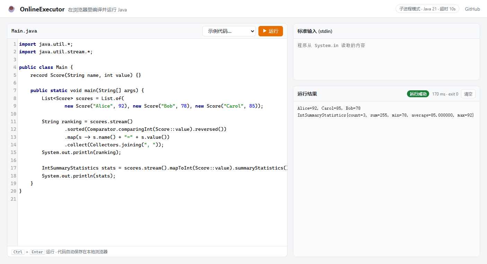
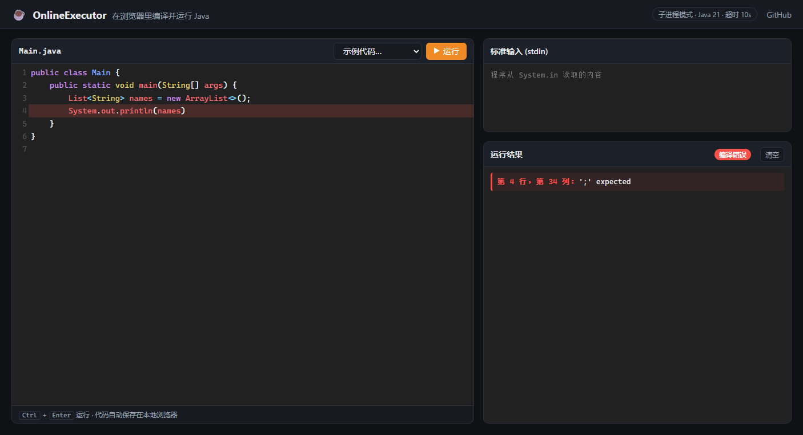
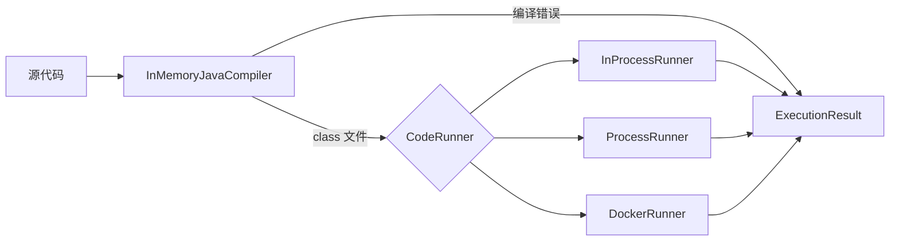

# OnlineExecutor

[](https://github.com/shaojunying/OnlineExecutor/actions/workflows/ci.yml)
[](https://adoptium.net/)
[](https://spring.io/projects/spring-boot)
[](LICENSE)

OnlineExecutor 是一个在线 Java 代码执行器。用户在浏览器里写 Java 代码，服务端在内存中编译并运行，再返回输出。

项目起点是《深入理解 Java 虚拟机》第 9.3 节「实战：自己动手实现远程执行功能」。书中的方法在同一个 JVM 里运行用户代码，无法隔离，也无法强制超时。本项目保留了这个方法，作为一种运行模式，另外增加了子进程模式和 Docker 沙箱模式。





## 功能

- 在内存中编译源代码，不写临时 `.java` 文件。支持包声明、内部类、匿名类、record 和 lambda。
- 编译错误显示行号和列号。点击错误，编辑器跳到对应行。
- 支持标准输入（stdin）。
- 返回运行状态、退出码、运行时间、stdout 和 stderr。
- 限制运行时间、输出大小、源代码长度和并发数。
- 提供 3 种运行模式，见下一节。

## 运行模式

用 `executor.mode` 选择运行模式，默认为 `process`。

| 模式 | 运行方式 | 能防止 | 不能防止 | 适用场景 |
|------|----------|--------|----------|----------|
| `in-process` | 在服务端 JVM 里运行，用书中的字节码替换方法捕获输出 | `System.exit` 结束服务；读取服务端环境变量；修改系统属性 | 读写文件、访问网络、启动进程；不打印的死循环会一直占用 CPU | 学习 JVM 类加载和字节码 |
| `process` | 每次运行启动一个子 JVM | 以上全部；死循环、内存耗尽、进程崩溃 | 读写文件、访问网络 | 本机自用、内网 |
| `docker` | 子 JVM 运行在受限容器里 | 以上全部；容器没有网络，文件系统只读，并限制内存、CPU 和进程数 | 容器逃逸类漏洞 | 公开部署 |

> **警告**：不要把 `in-process` 或 `process` 模式的服务开放给不信任的用户。用户代码能读取服务器上的文件，也能访问网络。

## 快速开始

需要 JDK 21 或更高版本。服务端用 `javac` 编译用户代码，所以只装 JRE 不能运行。

1. 克隆仓库。

   ```bash
   git clone https://github.com/shaojunying/OnlineExecutor.git
   cd OnlineExecutor
   ```

2. 启动服务。Maven Wrapper 会自动下载 Maven。

   ```bash
   ./mvnw spring-boot:run
   ```

3. 用浏览器打开 <http://localhost:8080>。

切换运行模式：

```bash
./mvnw spring-boot:run -Dspring-boot.run.arguments=--executor.mode=in-process
```

## 工作原理



### 编译

[`InMemoryJavaCompiler`](src/main/java/io/github/shaojunying/onlineexecutor/compile/InMemoryJavaCompiler.java) 用 `javax.tools.JavaCompiler` 编译源代码。

1. 用 javac 的语法树 API（`com.sun.source`）解析源代码，找出 public 顶层类。javac 要求文件名和这个类名一致。
2. 编译源代码。自定义的 `JavaFileManager` 把 javac 输出的每个 class 文件保存到内存，包括内部类和匿名类。
3. 编译时 class path 为空。用户代码只能使用 JDK 的类，看不到服务端的类。

### 同进程模式：书中的方法

[`InProcessRunner`](src/main/java/io/github/shaojunying/onlineexecutor/runner/inprocess/InProcessRunner.java) 用 3 个类实现书中的方法：

- [`ClassModifier`](src/main/java/io/github/shaojunying/onlineexecutor/runner/inprocess/ClassModifier.java) 遍历 class 文件的常量池，把 `java/lang/System` 替换为 `HackSystem` 的类名。这样用户代码里的 `System.out` 就变成了 `HackSystem.out`。它支持 JVMS §4.4 定义的全部 17 种常量。
- [`HackSystem`](src/main/java/io/github/shaojunying/onlineexecutor/runner/inprocess/HackSystem.java) 提供和 `System` 相同的静态成员。`out`、`err`、`in` 通过 `InheritableThreadLocal` 指向当前这次运行的缓冲区，所以并发请求互不干扰。`exit` 抛出异常，不结束服务。
- [`ByteArrayClassLoader`](src/main/java/io/github/shaojunying/onlineexecutor/runner/inprocess/ByteArrayClassLoader.java) 每次运行新建一个，所以同名类可以重复加载。父加载器是平台类加载器，用户代码看不到 Spring 等服务端的类。

Java 无法强制停止线程。超时后，`InProcessRunner` 会中断线程，并让之后的每次打印都抛出异常。不打印的死循环仍会占用 CPU，直到服务重启。

### 子进程模式和 Docker 模式

[`ProcessRunner`](src/main/java/io/github/shaojunying/onlineexecutor/runner/process/ProcessRunner.java) 的步骤：

1. 把 class 文件写到临时目录。
2. 启动子 JVM，参数包括 `-Xmx`、`-XX:+UseSerialGC`，并清空环境变量。
3. 把 stdin 写入子进程，读取 stdout 和 stderr。输出超过上限时，结束子进程。
4. 超时后，结束子进程和它启动的所有进程。
5. 删除临时目录。

[`DockerRunner`](src/main/java/io/github/shaojunying/onlineexecutor/runner/process/DockerRunner.java) 在 `docker run` 里启动同样的子 JVM，并加上这些限制：

```text
--network none --read-only --memory 384m --memory-swap 384m --cpus 1.0
--pids-limit 128 --cap-drop ALL --security-opt no-new-privileges --user 65534:65534
```

class 文件以只读方式挂载到容器的 `/code`。超时后，`DockerRunner` 用 `docker kill` 按容器名结束容器。

## API

### 运行代码

```bash
curl -s http://localhost:8080/api/executions \
  -H 'Content-Type: application/json' \
  -d '{"source": "public class Main { public static void main(String[] a) { System.out.println(6 * 7); } }", "stdin": ""}'
```

```json
{
  "status": "SUCCESS",
  "stdout": "42\n",
  "stderr": "",
  "exitCode": 0,
  "durationMillis": 412,
  "compileErrors": []
}
```

`status` 的取值：

| 值 | 含义 |
|----|------|
| `SUCCESS` | 程序正常结束，退出码为 0 |
| `COMPILE_ERROR` | 编译失败，错误在 `compileErrors` 里 |
| `RUNTIME_ERROR` | 有未捕获的异常，或退出码不为 0 |
| `TIMEOUT` | 运行超时，程序已被结束 |
| `OUTPUT_LIMIT_EXCEEDED` | 输出超过上限，程序已被结束 |

编译错误和运行错误都返回 HTTP 200。请求无效时返回 HTTP 400，没有空闲名额时返回 HTTP 429。错误响应使用 [RFC 9457](https://www.rfc-editor.org/rfc/rfc9457) 格式。

### 查看运行配置

`GET /api/runtime` 返回当前的运行模式、Java 版本和限制。

## 配置

所有配置项都在 [`ExecutorProperties`](src/main/java/io/github/shaojunying/onlineexecutor/config/ExecutorProperties.java) 中。配置项可以写在 `application.yml` 里，也可以用环境变量设置，例如 `EXECUTOR_MODE=docker`。

| 配置项 | 默认值 | 说明 |
|--------|--------|------|
| `executor.mode` | `process` | `in-process`、`process` 或 `docker` |
| `executor.timeout` | `10s` | 单次运行的时间上限 |
| `executor.max-source-length` | `65536` | 源代码的最大字符数 |
| `executor.max-stdin-length` | `65536` | stdin 的最大字符数 |
| `executor.max-output-bytes` | `65536` | stdout 和 stderr 各自的最大字节数 |
| `executor.max-concurrent` | `4` | 同时编译和运行的最大请求数 |
| `executor.heap-mb` | `128` | 子 JVM 的最大堆内存（MB） |
| `executor.docker.image` | 空 | 运行用户代码的镜像。为空时使用 `eclipse-temurin:<服务端 Java 版本>-jre`。镜像的 Java 版本不能低于服务端 |
| `executor.docker.memory-mb` | `384` | 容器内存上限（MB），必须大于 `heap-mb` |
| `executor.docker.cpus` | `1.0` | 容器 CPU 上限 |
| `executor.docker.pids-limit` | `128` | 容器内的最大进程和线程数 |

## 部署

### 用 Docker 运行服务

```bash
docker build -t online-executor .
docker run --rm -p 8080:8080 online-executor
```

镜像默认使用 `process` 模式，子 JVM 运行在服务所在的容器里。

### 使用 docker 模式

docker 模式需要调用 Docker daemon。服务直接运行在主机上时：

1. 预先拉取镜像，避免第一次运行时因下载镜像而超时。镜像的 Java 版本要和服务端一致，下面以 Java 21 为例。

   ```bash
   docker pull eclipse-temurin:21-jre
   ```

2. 启动服务。

   ```bash
   EXECUTOR_MODE=docker java -jar target/online-executor-1.0.0.jar
   ```

服务本身运行在容器里时，还要满足两个条件：

- 把 `/var/run/docker.sock` 挂载到服务容器，并安装 docker CLI。
- 服务写 class 文件的临时目录，必须在主机上有相同的路径。原因是 `--mount` 的源路径由 Docker daemon 在主机上解析。用 `-Djava.io.tmpdir` 指定这个目录。

> **警告**：挂载 `docker.sock` 等于把主机的 root 权限交给服务容器。只在可信的主机上这样部署。

## 开发

```bash
./mvnw verify
```

这个命令编译代码、运行全部测试，并在 `target/site/jacoco` 生成覆盖率报告。本机有 Docker 且已拉取 `eclipse-temurin:<Java 版本>-jre` 时，`DockerRunnerTest` 才会运行，否则跳过。

三种运行模式共用一套测试：[`CodeRunnerContractTest`](src/test/java/io/github/shaojunying/onlineexecutor/runner/CodeRunnerContractTest.java)。新增运行模式时，继承这个类即可。

### 项目结构

```text
src/main/java/io/github/shaojunying/onlineexecutor/
├── OnlineExecutorApplication.java
├── compile/                    # 内存编译
│   └── InMemoryJavaCompiler.java
├── config/                     # 配置项，按模式创建 CodeRunner
├── runner/
│   ├── CodeRunner.java         # 运行模式的接口
│   ├── inprocess/              # 同进程模式（书中的方法）
│   │   ├── ByteArrayClassLoader.java
│   │   ├── ClassModifier.java
│   │   └── HackSystem.java
│   └── process/                # 子进程模式和 Docker 模式
├── service/                    # 校验请求、限制并发
└── web/                        # REST API
src/main/resources/static/      # 前端页面
```

## 更新日志

见 [CHANGELOG.md](CHANGELOG.md)。

## 致谢

- 周志明《深入理解 Java 虚拟机》第 9.3 节。
- [CodeMirror](https://codemirror.net/5/) 代码编辑器。

## 开源协议

[MIT](LICENSE)
