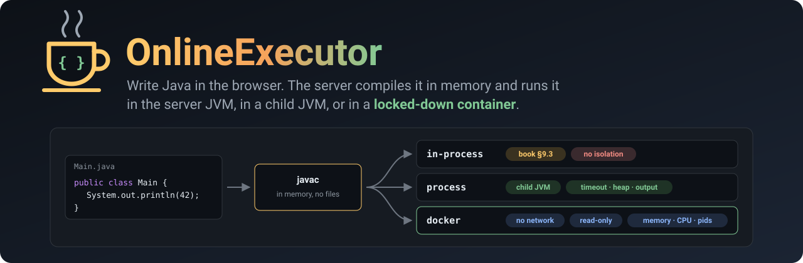
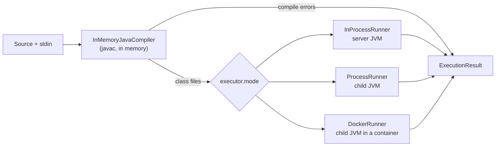

<p align="center">
  
</p>

<p align="center">
  <a href="LICENSE"></a>
  <a href="https://github.com/shaojunying/OnlineExecutor/releases"></a>
  <a href="https://github.com/shaojunying/OnlineExecutor/actions/workflows/ci.yml"></a>
  
  
  
  <a href="https://github.com/shaojunying/OnlineExecutor/stargazers"></a>
</p>

<p align="center">
  <b>English</b> · <a href="README.zh-CN.md">中文</a>
</p>

---

**OnlineExecutor compiles and runs Java code that you write in the browser.** The server compiles the source in memory with `javac`. Then it runs the program in one of three modes and returns the output, the exit code and the run time. You select the mode with one setting. The modes go from the class-loader technique of a classic JVM book to a locked-down Docker container.

```bash
curl -s localhost:8080/api/executions -H 'Content-Type: application/json' \
  -d '{"source": "public class Main { public static void main(String[] a) { System.out.println(6 * 7); } }"}'
# {"status":"SUCCESS","stdout":"42\n","stderr":"","exitCode":0,"durationMillis":63,"compileErrors":[]}
```

> [!NOTE]
> The project started from section 9.3 of *Understanding the JVM* (《深入理解 Java 虚拟机》) by Zhou Zhiming, "Build a remote execution feature yourself". The `in-process` mode keeps that technique. Version 1.0 adds the `process` and `docker` modes, because the book's technique cannot isolate code or stop it by force.

## ✨ Features

- ⚡ **Compiles in memory**: no `.java` or `.class` files for the compile step. Packages, nested and anonymous classes, records and lambdas work.
- 🧭 **Clear compile errors**: each error has a line and a column. Click an error to go to that line in the editor.
- ⌨️ **Standard input**: give the program text to read from `System.in`.
- 🚦 **One result shape**: status, exit code, run time, stdout and stderr, for the web page and for the JSON API.
- 🧱 **Three execution modes**: from no isolation to a container without network. See [execution modes](#-execution-modes).
- 🛑 **Limits on every run**: time, output size, source size and the number of runs at the same time.
- 📦 **One jar**: the editor ([CodeMirror](https://codemirror.net/5/)) and all assets are in the jar. The page loads nothing from a CDN.

## 🖼️ Screenshots

<table>
  <tr>
    <td width="50%"></td>
    <td width="50%"></td>
  </tr>
  <tr>
    <td align="center"><sub>A successful run</sub></td>
    <td align="center"><sub>A compile error, with the line marked</sub></td>
  </tr>
</table>

## 🚀 Quick start

You need JDK 21 or later. A JRE is not sufficient, because the server compiles code with `javac`.

```bash
git clone https://github.com/shaojunying/OnlineExecutor.git
cd OnlineExecutor
./mvnw spring-boot:run
```

Open <http://localhost:8080>. The Maven Wrapper downloads Maven on the first run.

To use a different mode, give the mode as an argument:

```bash
./mvnw spring-boot:run -Dspring-boot.run.arguments=--executor.mode=in-process
```

You can also download the jar from the [latest release](https://github.com/shaojunying/OnlineExecutor/releases/latest) and run it with `java -jar online-executor-1.0.0.jar`.

## 🧱 Execution modes

Set `executor.mode`. The default is `process`.

| | `System.exit` cannot stop the server | Endless loop is stopped | Memory is limited | No server secrets in env | No file access | No network |
|---|:---:|:---:|:---:|:---:|:---:|:---:|
| `in-process` | ✅ | ⚠️ only if it prints | ❌ | ✅ | ❌ | ❌ |
| `process` | ✅ | ✅ | ✅ | ✅ | ❌ | ❌ |
| **`docker`** | ✅ | ✅ | ✅ | ✅ | ✅ read-only | ✅ |

- 📖 **`in-process`**: the book's technique. Use it to learn class loading and the class-file format.
- 🧒 **`process`**: a child JVM for each run. Use it on your own machine or on a trusted network.
- 🐳 **`docker`**: a child JVM in a container. Use it when other people can reach the server.

> [!WARNING]
> Do not expose an `in-process` or `process` server to users that you do not trust. Their code can read files on the server and use the network.

## 🧩 How it works



**Compile.** [`InMemoryJavaCompiler`](src/main/java/io/github/shaojunying/onlineexecutor/compile/InMemoryJavaCompiler.java) parses the source with the javac tree API to find the public class, because javac requires the file name to match it. A custom `JavaFileManager` keeps every class file that javac writes, including nested and anonymous classes. The class path is empty, so user code sees the JDK only.

**Run in the server JVM (the book's technique).** [`InProcessRunner`](src/main/java/io/github/shaojunying/onlineexecutor/runner/inprocess/InProcessRunner.java) uses three classes:

- [`ClassModifier`](src/main/java/io/github/shaojunying/onlineexecutor/runner/inprocess/ClassModifier.java) walks the constant pool of each class file and replaces `java/lang/System` with the name of `HackSystem`. It knows all 17 constant types of JVMS §4.4.
- [`HackSystem`](src/main/java/io/github/shaojunying/onlineexecutor/runner/inprocess/HackSystem.java) has the same static members as `System`. Its `in`, `out` and `err` use the buffers of the current run through an `InheritableThreadLocal`, so two runs never mix. Its `exit` throws instead of stopping the server.
- [`ByteArrayClassLoader`](src/main/java/io/github/shaojunying/onlineexecutor/runner/inprocess/ByteArrayClassLoader.java) is new for each run, so a class with the same name loads again. Its parent is the platform class loader, so user code cannot see Spring or other server classes.

**Run in a child JVM.** [`ProcessRunner`](src/main/java/io/github/shaojunying/onlineexecutor/runner/process/ProcessRunner.java) writes the class files to a temporary directory and starts `java` with a heap limit and an empty environment. When the time or the output goes over the limit, it kills the process and all its child processes. [`DockerRunner`](src/main/java/io/github/shaojunying/onlineexecutor/runner/process/DockerRunner.java) starts the same JVM with `docker run`:

```text
--network none --read-only --memory 384m --memory-swap 384m --cpus 1.0
--pids-limit 128 --cap-drop ALL --security-opt no-new-privileges --user 65534:65534
```

The class files are mounted read-only at `/code`. On a timeout, `DockerRunner` stops the container by name with `docker kill`.

## 🚦 Results

`POST /api/executions` with `{"source": "...", "stdin": "..."}` returns one of these statuses:

| | Status | Meaning |
|:--:|:--|:--|
| ✅ | `SUCCESS` | the program ended with exit code 0 |
| 🧱 | `COMPILE_ERROR` | the source did not compile. See `compileErrors`. |
| ❌ | `RUNTIME_ERROR` | an uncaught exception, or an exit code that is not 0 |
| ⏱️ | `TIMEOUT` | the program ran too long and was stopped |
| 📜 | `OUTPUT_LIMIT_EXCEEDED` | the program wrote too much and was stopped |

All of these use HTTP 200. An invalid request gets HTTP 400. When all execution slots are in use, the server sends HTTP 429. Error bodies use [RFC 9457](https://www.rfc-editor.org/rfc/rfc9457) problem details. `GET /api/runtime` returns the mode, the Java version and the limits.

<details>
<summary><b>⚙️ Configuration</b></summary>

Put the settings in `application.yml`, or use environment variables such as `EXECUTOR_MODE=docker`. All settings are in [`ExecutorProperties`](src/main/java/io/github/shaojunying/onlineexecutor/config/ExecutorProperties.java).

| Setting | Default | What it does |
|:--|:--|:--|
| `executor.mode` | `process` | `in-process`, `process` or `docker` |
| `executor.timeout` | `10s` | time limit for one run |
| `executor.max-source-length` | `65536` | maximum source length, in characters |
| `executor.max-stdin-length` | `65536` | maximum stdin length, in characters |
| `executor.max-output-bytes` | `65536` | maximum bytes for stdout, and the same again for stderr |
| `executor.max-concurrent` | `4` | maximum number of runs at the same time |
| `executor.heap-mb` | `128` | heap limit of the child JVM, in MB |
| `executor.docker.image` | empty | image for `docker` mode. Empty means `eclipse-temurin:<server Java version>-jre`. |
| `executor.docker.memory-mb` | `384` | container memory limit, in MB. It must be larger than `heap-mb`. |
| `executor.docker.cpus` | `1.0` | container CPU limit |
| `executor.docker.pids-limit` | `128` | maximum processes and threads in the container |

</details>

<details>
<summary><b>🐳 Deployment</b></summary>

Run the server in a container (`process` mode, the child JVMs run in the same container):

```bash
docker build -t online-executor .
docker run --rm -p 8080:8080 online-executor
```

Use `docker` mode with the server on the host:

```bash
docker pull eclipse-temurin:21-jre      # the same Java version as the server
EXECUTOR_MODE=docker java -jar online-executor-1.0.0.jar
```

Pull the image before the first run. If you do not, the first run downloads the image and can time out.

If the server itself runs in a container and uses `docker` mode, do these two things:

1. Mount `/var/run/docker.sock` into the server container, and install the docker CLI in it.
2. Set `-Djava.io.tmpdir` to a directory that has the same path on the host. The Docker daemon finds the `--mount` source on the host.

> [!CAUTION]
> Access to `docker.sock` gives the server container root access to the host. Do this only on a host that you trust.

</details>

## 🛡️ Limits

- Java cannot stop a thread by force. In `in-process` mode, a loop that never prints continues to use CPU after its timeout, until the server restarts.
- In `in-process` mode, parallel streams and other common-pool threads do not inherit the run's output. Their output goes to the server console.
- `process` mode does not block file access or the network. Use `docker` mode for that.
- `docker` mode depends on the isolation of the container runtime. It does not protect against a container escape in the kernel or in Docker.

<details>
<summary><b>🧪 Development</b></summary>

- `./mvnw verify` compiles the code, runs all tests and writes a coverage report to `target/site/jacoco`.
- [`CodeRunnerContractTest`](src/test/java/io/github/shaojunying/onlineexecutor/runner/CodeRunnerContractTest.java) runs the same cases against all three modes. To add a mode, extend this class.
- `DockerRunnerTest` runs only when Docker is available and `eclipse-temurin:<Java version>-jre` is present. Otherwise it is skipped.
- CI runs on Java 21 and Java 25, with the Docker tests, and builds the Docker image.

```text
src/main/java/io/github/shaojunying/onlineexecutor/
├── compile/              in-memory compiler
├── config/               settings, and the CodeRunner for the mode
├── runner/
│   ├── CodeRunner.java   the interface for an execution mode
│   ├── inprocess/        the book's technique
│   └── process/          child JVM and Docker
├── service/              input checks, concurrency limit
└── web/                  REST API
src/main/resources/static/  the web page
```

</details>

## 📝 Changelog

See [CHANGELOG.md](CHANGELOG.md) (in Chinese).

## 📄 License

[MIT](LICENSE)
