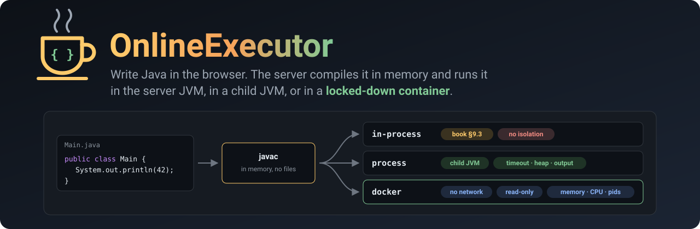
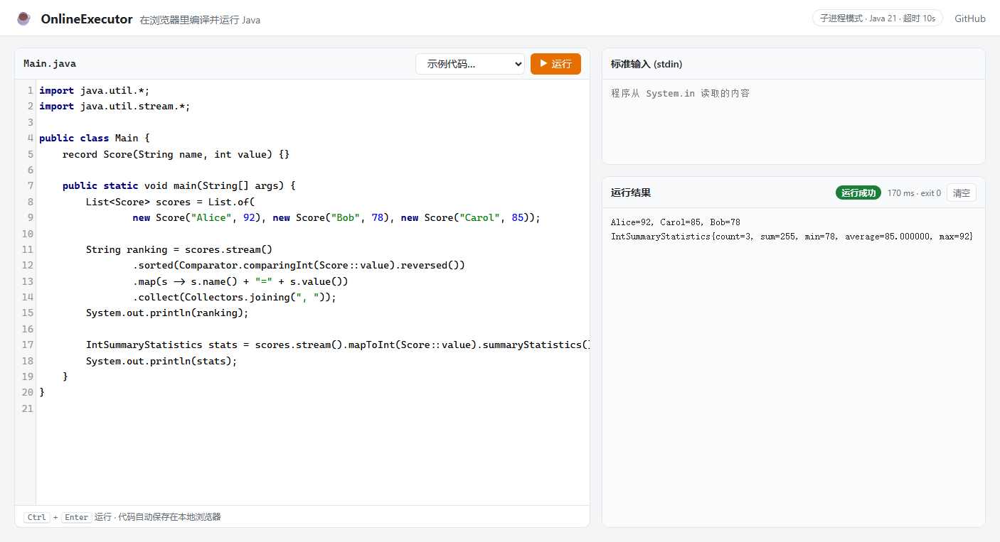
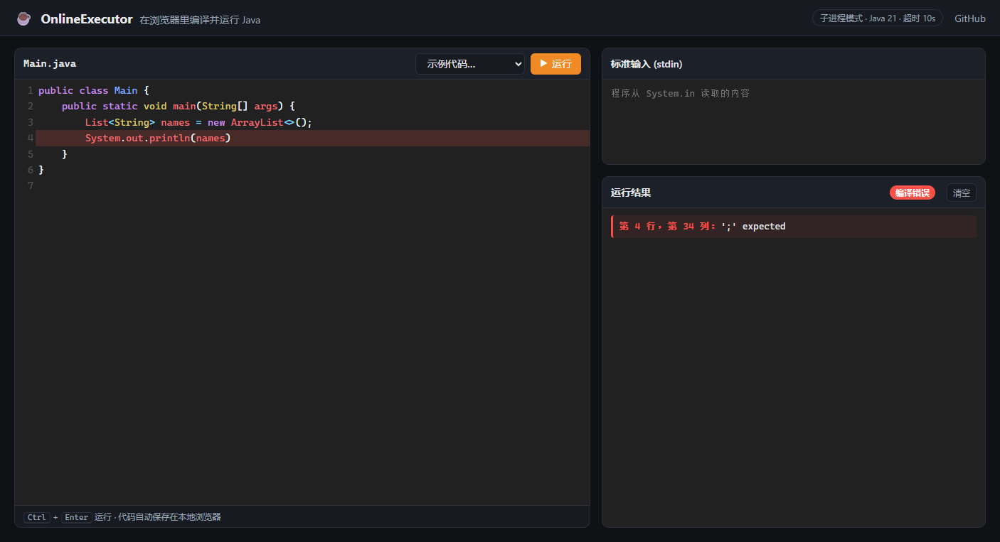
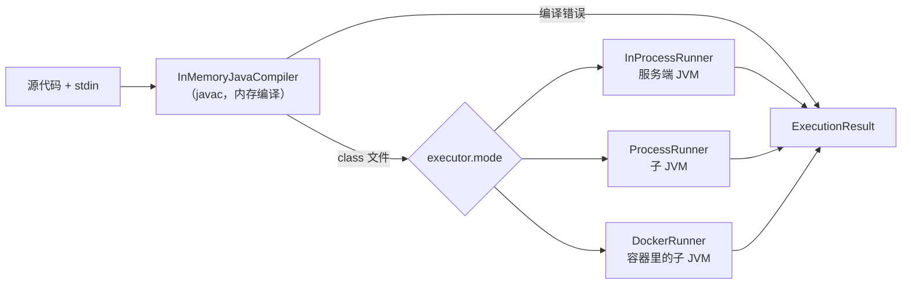

<p align="center">
  
</p>

<p align="center">
  <a href="LICENSE"></a>
  <a href="https://github.com/shaojunying/OnlineExecutor/releases"></a>
  <a href="https://github.com/shaojunying/OnlineExecutor/actions/workflows/ci.yml"></a>
  
  
  
  <a href="https://github.com/shaojunying/OnlineExecutor/stargazers"></a>
</p>

<p align="center">
  <a href="README.md">English</a> · <b>中文</b>
</p>

---

**OnlineExecutor 编译并运行你在浏览器里写的 Java 代码。** 服务端用 `javac` 在内存中编译源代码，再用三种模式之一运行程序，返回输出、退出码和运行时间。运行模式用一个配置项切换。三种模式从一本经典 JVM 书里的类加载方法，一直到受限的 Docker 容器。

```bash
curl -s localhost:8080/api/executions -H 'Content-Type: application/json' \
  -d '{"source": "public class Main { public static void main(String[] a) { System.out.println(6 * 7); } }"}'
# {"status":"SUCCESS","stdout":"42\n","stderr":"","exitCode":0,"durationMillis":63,"compileErrors":[]}
```

> [!NOTE]
> 项目起点是周志明《深入理解 Java 虚拟机》第 9.3 节「实战：自己动手实现远程执行功能」。`in-process` 模式保留了书中的方法。书中的方法无法隔离代码，也无法强制停止代码，所以 1.0 版新增了 `process` 和 `docker` 两种模式。

## ✨ 功能

- ⚡ **内存编译**：编译时不写 `.java` 或 `.class` 文件。支持包声明、内部类、匿名类、record 和 lambda。
- 🧭 **编译错误清楚**：每个错误都带行号和列号。点击错误，编辑器跳到对应行。
- ⌨️ **标准输入**：可以给程序提供 `System.in` 的内容。
- 🚦 **统一的结果格式**：网页和 JSON API 都返回状态、退出码、运行时间、stdout 和 stderr。
- 🧱 **三种运行模式**：从不隔离，到没有网络的容器。见[运行模式](#-运行模式)。
- 🛑 **每次运行都有上限**：限制运行时间、输出大小、源代码长度和并发数。
- 📦 **只有一个 jar**：编辑器（[CodeMirror](https://codemirror.net/5/)）和所有静态资源都在 jar 里，页面不从 CDN 加载任何内容。

## 🖼️ 截图

<table>
  <tr>
    <td width="50%"></td>
    <td width="50%"></td>
  </tr>
  <tr>
    <td align="center"><sub>运行成功</sub></td>
    <td align="center"><sub>编译错误，并标出出错的行</sub></td>
  </tr>
</table>

## 🚀 快速开始

需要 JDK 21 或更高版本。服务端用 `javac` 编译代码，所以只装 JRE 不能运行。

```bash
git clone https://github.com/shaojunying/OnlineExecutor.git
cd OnlineExecutor
./mvnw spring-boot:run
```

用浏览器打开 <http://localhost:8080>。第一次运行时，Maven Wrapper 会自动下载 Maven。

切换运行模式时，把模式作为参数传入：

```bash
./mvnw spring-boot:run -Dspring-boot.run.arguments=--executor.mode=in-process
```

也可以从[最新 Release](https://github.com/shaojunying/OnlineExecutor/releases/latest) 下载 jar，用 `java -jar online-executor-1.0.0.jar` 运行。

## 🧱 运行模式

用 `executor.mode` 选择运行模式，默认为 `process`。

| | `System.exit` 不会结束服务 | 能停止死循环 | 限制内存 | 读不到服务端环境变量 | 不能访问文件 | 不能访问网络 |
|---|:---:|:---:|:---:|:---:|:---:|:---:|
| `in-process` | ✅ | ⚠️ 只限会打印的循环 | ❌ | ✅ | ❌ | ❌ |
| `process` | ✅ | ✅ | ✅ | ✅ | ❌ | ❌ |
| **`docker`** | ✅ | ✅ | ✅ | ✅ | ✅ 只读 | ✅ |

- 📖 **`in-process`**：书中的方法。适合学习类加载和 class 文件格式。
- 🧒 **`process`**：每次运行启动一个子 JVM。适合本机自用或可信的内网。
- 🐳 **`docker`**：子 JVM 运行在容器里。服务对外开放时，用这个模式。

> [!WARNING]
> 不要把 `in-process` 或 `process` 模式的服务开放给不信任的用户。用户代码能读取服务器上的文件，也能访问网络。

## 🧩 工作原理



**编译。** [`InMemoryJavaCompiler`](src/main/java/io/github/shaojunying/onlineexecutor/compile/InMemoryJavaCompiler.java) 先用 javac 的语法树 API 解析源代码，找出 public 类，因为 javac 要求文件名和这个类名一致。自定义的 `JavaFileManager` 保存 javac 输出的每个 class 文件，包括内部类和匿名类。编译时 class path 为空，用户代码只能使用 JDK 的类。

**在服务端 JVM 里运行（书中的方法）。** [`InProcessRunner`](src/main/java/io/github/shaojunying/onlineexecutor/runner/inprocess/InProcessRunner.java) 用到 3 个类：

- [`ClassModifier`](src/main/java/io/github/shaojunying/onlineexecutor/runner/inprocess/ClassModifier.java) 遍历每个 class 文件的常量池，把 `java/lang/System` 替换为 `HackSystem` 的类名。它支持 JVMS §4.4 定义的全部 17 种常量。
- [`HackSystem`](src/main/java/io/github/shaojunying/onlineexecutor/runner/inprocess/HackSystem.java) 提供和 `System` 相同的静态成员。`in`、`out`、`err` 通过 `InheritableThreadLocal` 指向当前这次运行的缓冲区，所以两次运行的输出不会混在一起。`exit` 抛出异常，不结束服务。
- [`ByteArrayClassLoader`](src/main/java/io/github/shaojunying/onlineexecutor/runner/inprocess/ByteArrayClassLoader.java) 每次运行新建一个，所以同名类可以重复加载。它的父加载器是平台类加载器，用户代码看不到 Spring 等服务端的类。

**在子 JVM 里运行。** [`ProcessRunner`](src/main/java/io/github/shaojunying/onlineexecutor/runner/process/ProcessRunner.java) 把 class 文件写到临时目录，再启动 `java`，并限制堆内存、清空环境变量。运行时间或输出超过上限时，它结束子进程和子进程启动的所有进程。[`DockerRunner`](src/main/java/io/github/shaojunying/onlineexecutor/runner/process/DockerRunner.java) 用 `docker run` 启动同样的 JVM：

```text
--network none --read-only --memory 384m --memory-swap 384m --cpus 1.0
--pids-limit 128 --cap-drop ALL --security-opt no-new-privileges --user 65534:65534
```

class 文件以只读方式挂载到容器的 `/code`。超时后，`DockerRunner` 用 `docker kill` 按容器名结束容器。

## 🚦 运行结果

向 `POST /api/executions` 发送 `{"source": "...", "stdin": "..."}`，返回以下状态之一：

| | 状态 | 含义 |
|:--:|:--|:--|
| ✅ | `SUCCESS` | 程序正常结束，退出码为 0 |
| 🧱 | `COMPILE_ERROR` | 编译失败，错误在 `compileErrors` 里 |
| ❌ | `RUNTIME_ERROR` | 有未捕获的异常，或退出码不为 0 |
| ⏱️ | `TIMEOUT` | 运行超时，程序已被结束 |
| 📜 | `OUTPUT_LIMIT_EXCEEDED` | 输出超过上限，程序已被结束 |

以上状态都返回 HTTP 200。请求无效时返回 HTTP 400。所有运行名额都在使用时，返回 HTTP 429。错误响应使用 [RFC 9457](https://www.rfc-editor.org/rfc/rfc9457) 格式。`GET /api/runtime` 返回当前的运行模式、Java 版本和各项上限。

<details>
<summary><b>⚙️ 配置</b></summary>

配置项可以写在 `application.yml` 里，也可以用环境变量设置，例如 `EXECUTOR_MODE=docker`。所有配置项都在 [`ExecutorProperties`](src/main/java/io/github/shaojunying/onlineexecutor/config/ExecutorProperties.java) 中。

| 配置项 | 默认值 | 说明 |
|:--|:--|:--|
| `executor.mode` | `process` | `in-process`、`process` 或 `docker` |
| `executor.timeout` | `10s` | 单次运行的时间上限 |
| `executor.max-source-length` | `65536` | 源代码的最大字符数 |
| `executor.max-stdin-length` | `65536` | stdin 的最大字符数 |
| `executor.max-output-bytes` | `65536` | stdout 和 stderr 各自的最大字节数 |
| `executor.max-concurrent` | `4` | 同时运行的最大请求数 |
| `executor.heap-mb` | `128` | 子 JVM 的最大堆内存（MB） |
| `executor.docker.image` | 空 | `docker` 模式使用的镜像。为空时使用 `eclipse-temurin:<服务端 Java 版本>-jre` |
| `executor.docker.memory-mb` | `384` | 容器内存上限（MB），必须大于 `heap-mb` |
| `executor.docker.cpus` | `1.0` | 容器 CPU 上限 |
| `executor.docker.pids-limit` | `128` | 容器内的最大进程和线程数 |

</details>

<details>
<summary><b>🐳 部署</b></summary>

用容器运行服务（`process` 模式，子 JVM 运行在同一个容器里）：

```bash
docker build -t online-executor .
docker run --rm -p 8080:8080 online-executor
```

服务运行在主机上时，使用 `docker` 模式：

```bash
docker pull eclipse-temurin:21-jre      # 和服务端相同的 Java 版本
EXECUTOR_MODE=docker java -jar online-executor-1.0.0.jar
```

第一次运行前先拉取镜像。否则第一次运行要下载镜像，可能超时。

服务本身运行在容器里、又要使用 `docker` 模式时，要做两件事：

1. 把 `/var/run/docker.sock` 挂载到服务容器，并在容器里安装 docker CLI。
2. 用 `-Djava.io.tmpdir` 指定一个在主机上路径相同的目录。原因是 Docker daemon 在主机上查找 `--mount` 的源路径。

> [!CAUTION]
> 挂载 `docker.sock` 等于把主机的 root 权限交给服务容器。只在可信的主机上这样部署。

</details>

## 🛡️ 局限

- Java 无法强制停止线程。`in-process` 模式下，不打印的死循环在超时后仍会占用 CPU，直到服务重启。
- `in-process` 模式下，并行流等公共线程池的线程不继承本次运行的输出。这些线程的输出写到服务端控制台。
- `process` 模式不阻止访问文件和网络。需要这种隔离时，用 `docker` 模式。
- `docker` 模式依赖容器运行时的隔离能力，不能防御内核或 Docker 本身的容器逃逸漏洞。

<details>
<summary><b>🧪 开发</b></summary>

- `./mvnw verify` 编译代码、运行全部测试，并在 `target/site/jacoco` 生成覆盖率报告。
- [`CodeRunnerContractTest`](src/test/java/io/github/shaojunying/onlineexecutor/runner/CodeRunnerContractTest.java) 对三种模式运行同一组测试。新增运行模式时，继承这个类即可。
- 本机有 Docker 且已拉取 `eclipse-temurin:<Java 版本>-jre` 时，`DockerRunnerTest` 才会运行，否则跳过。
- CI 在 Java 21 和 Java 25 上运行全部测试（包括 Docker 测试），并构建 Docker 镜像。

```text
src/main/java/io/github/shaojunying/onlineexecutor/
├── compile/              内存编译
├── config/               配置项，按模式创建 CodeRunner
├── runner/
│   ├── CodeRunner.java   运行模式的接口
│   ├── inprocess/        书中的方法
│   └── process/          子 JVM 和 Docker
├── service/              校验请求、限制并发
└── web/                  REST API
src/main/resources/static/  前端页面
```

</details>

## 📝 更新日志

见 [CHANGELOG.md](CHANGELOG.md)。

## 📄 开源协议

[MIT](LICENSE)
